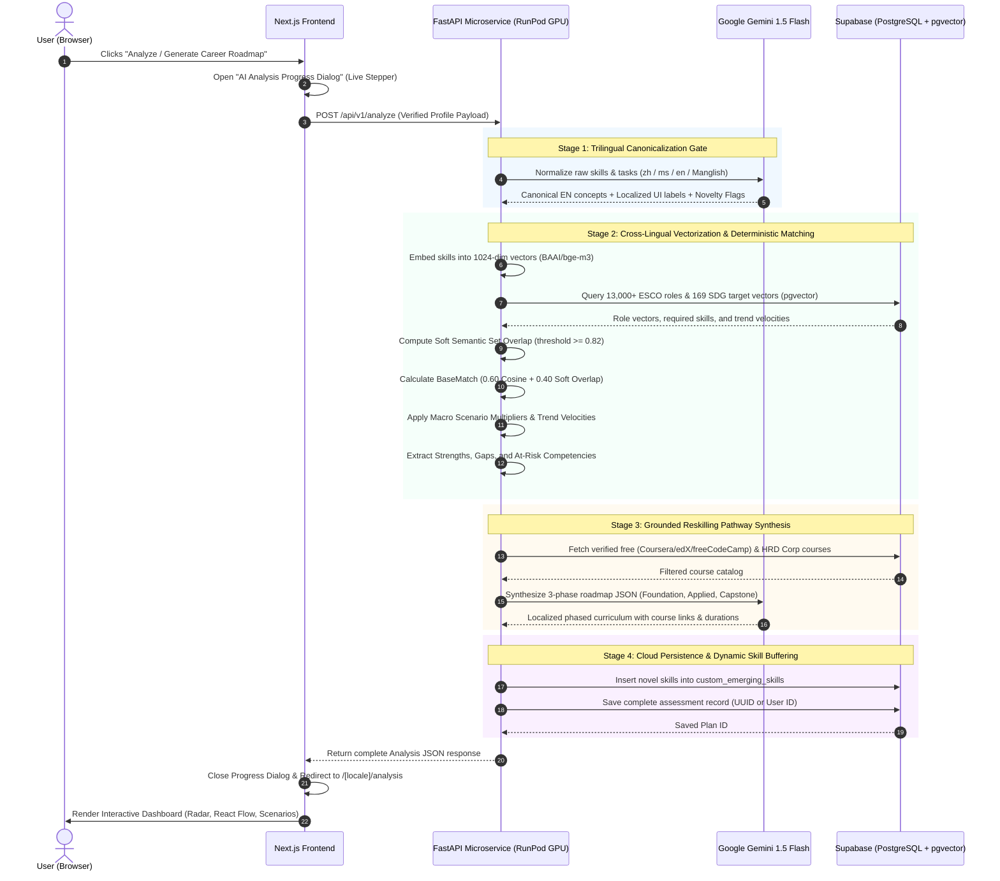
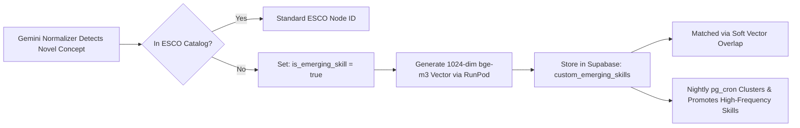

# SkillVerse AI — Analysis Engine & Pathway Synthesis Specification

**Document Version:** 1.0.0  
**Project:** SkillVerse AI (SDC-HACKATHON-2026 — Domain 1)  
**Status:** Approved for Implementation  

---

## 1. Executive Summary & Purpose

The **Analysis Engine** is the computational and intelligence core of SkillVerse AI. Triggered when the user completes the profile intake and clicks **"Analyze"**, the engine:
1. Normalizes trilingual user inputs (English, Bahasa Melayu, Chinese, Manglish) into canonical concepts before vectorization.
2. Employs **RunPod GPU inference (`BAAI/bge-m3`)** and **Supabase `pgvector`** for semantic matching against 13,000+ ESCO/O\*NET roles and 169 UN SDG targets.
3. Implements **Soft Semantic Set Overlap** to prevent keyword/synonym mismatch penalties.
4. Manages a **Dynamic Emerging Skills Buffer** to gracefully absorb new AI and green technology competencies.
5. Generates deterministic, explainable match scores merged with live labor trend signals (ArXiv `cs.AI`, RemoteOK, Adzuna).
6. Synthesizes a structured 3-phase reskilling roadmap grounded in verified free courses and **Malaysian HRD Corp-claimable** programs using **Google Gemini 1.5 Flash**.

---

## 2. End-to-End Analysis Workflow



---

## 3. Pre-Vectorization: Trilingual Standardization Gate

Users describe competencies in English, Bahasa Melayu, Chinese, or colloquial code-mixed phrasing. Direct vector embedding of raw phrases causes semantic divergence.

### The Gate Architecture:
Before vectorization, all input skills pass through Gemini 1.5 Flash:

```json
// Example: Raw User Input: "pandai handle customer dispute masa shift malam dan key-in invois"
{
  "raw_input": "pandai handle customer dispute masa shift malam dan key-in invois",
  "canonical_en": "Customer Conflict Resolution & Invoice Processing",
  "localized_labels": {
    "en": "Customer Conflict Resolution & Invoicing",
    "ms": "Penyelesaian Pertikaian Pelanggan & Penginvoisan",
    "zh": "客户冲突解决与发票处理"
  },
  "domain_category": "Customer Support & Office Administration",
  "mapped_esco_concepts": [
    "handle customer complaints",
    "process invoices"
  ],
  "confidence_score": 0.94,
  "is_emerging_skill": false
}
```

* **Vectorization Layer:** The RunPod GPU embeds `canonical_en` + `domain_category`.
* **Presentation Layer:** The frontend displays `localized_labels[user_locale]` ensuring native user comprehension.

---

## 4. Mathematical & Algorithmic Methodology

### 4.1 Soft Semantic Set Overlap (Solving Synonym & Mismatch Penalties)
Traditional exact ID set matching penalizes users whose skill labels differ slightly from ESCO taxonomy terms (e.g. *"Prompt Crafting"* vs. *"Prompt Engineering"*).

We implement **Soft Semantic Overlap**:
For each user skill $s_u \in S_{\text{user}}$, we evaluate its maximum cosine similarity against all skills $s_r \in S_{\text{role}}$ required by prospective role $R$:

$$\text{SoftMatch}(s_u, S_{\text{role}}) = \max_{s_r \in S_{\text{role}}} \left(\text{CosineSimilarity}(v_{s_u}, v_{s_r})\right)$$

* **Match Criterion:** If $\text{SoftMatch}(s_u, S_{\text{role}}) \ge 0.82$, $s_u$ is counted as a **Matched Strength**.
* **Gap Criterion:** Role skills $s_r$ with no user match above $0.82$ are categorized as **Skills to Acquire (Gap)**.

### 4.2 Deterministic Explainable Role Matching Formula
To guarantee deterministic, explainable results without black-box bias:

$$\text{BaseMatch} = 0.60 \times \text{CosineSimilarity}(V_{\text{User}}, V_{\text{Role}}) + 0.40 \times \frac{\sum_{s_u \in S_{\text{user}}} \mathbf{1}_{\{\text{SoftMatch}(s_u, S_{\text{role}}) \ge 0.82\}}}{|S_{\text{role}}|}$$

$$\text{FinalScore} = \text{Clip}(\text{BaseMatch} \times \text{ScenarioMultiplier}, 0.0, 1.0)$$

### 4.3 Macro Scenario Multipliers
Users can toggle macro uncertainty scenarios, adjusting role demand weights dynamically:

| Macro Scenario | Target Sector Weights | Rationale |
| :--- | :--- | :--- |
| **Scenario 1: Moderate Phased AI Integration** | Default baseline ($1.0\times$ all roles) | Standard progressive technological transition. |
| **Scenario 2: Accelerated Autonomous Disruption** | High-automation roles: $0.80\times$<br>AI Orchestration/Systems: $1.25\times$ | Models rapid replacement of clerical/routine tasks. |
| **Scenario 3: Green & ESG Economy Priority** | Clean Energy, Smart Agritech, ESG: $1.30\times$<br>Fossil/Traditional: $0.85\times$ | Reflects national net-zero and SDG mandate investments. |

### 4.4 Live Trend Velocity Calculation
Nightly background jobs (`pg_cron`) ingest public feeds (ArXiv `cs.AI`, RemoteOK, Adzuna). The signal velocity ($V_s$) across current window $C_t$ (30 days) and previous window $C_{t-1}$ is computed:

$$V_s = \frac{C_t - C_{t-1}}{\max(C_{t-1}, 1)}$$

* **Emerging Skill:** $V_s > +0.25$ $\implies$ Demand Multiplier $> 1.0$ (Marked with green trending badge).
* **Stable Skill:** $-0.15 \le V_s \le +0.25$ $\implies$ Demand Multiplier $= 1.0$.
* **Declining / At-Risk Skill:** $V_s < -0.15$ $\implies$ Demand Multiplier $< 1.0$ (Marked with red automation alert badge).

### 4.5 Objective UN SDG Target Affinity
The official definitions of all 169 UN SDG targets are embedded as vectors $V_{T_i}$. For any role $R$:

$$\text{SDG\_Affinity}(R, T_i) = \frac{V_R \cdot V_{T_i}}{\|V_R\| \times \|V_{T_i}\|}$$

Top scoring targets are highlighted on the dashboard (e.g., Target 4.4, Target 8.2, Target 9.4).

---

## 5. Dynamic Emerging Skills Buffer & Taxonomy Evolution

To prevent the skills library from becoming stale when new AI or green competencies appear:



### 1. Dynamic Buffer Table: `custom_emerging_skills`
Unrecognized skills are not dropped; they are stored with their computed vector:
* Stored with: `canonical_en`, `localized_labels`, `embedding` (vector 1024), `first_seen_at`, `frequency_count`.

### 2. Community Telemetry & Audit Table: `skill_mismatch_audit_logs`
When a user modifies, deletes, or overrides an AI-suggested skill in the form, the action is logged:

```sql
create table skill_mismatch_audit_logs (
    id uuid primary key default gen_random_uuid(),
    raw_user_input text not null,
    ai_suggested_canonical text not null,
    user_action text not null check (user_action in ('deleted', 'renamed', 'replaced')),
    user_replacement text,
    locale text not null,
    created_at timestamp with time zone default now()
);
```
* **Benefit:** Provides telemetry to audit frequent misclassifications across languages and periodically refine few-shot Gemini prompts.

---

## 6. Grounded Personalized Reskilling Pathway Synthesis

The Pathway Generator transforms the calculated **Skills Gap** into an actionable, multi-phase curriculum grounded in real-world educational resources:

### 3-Phase Milestone Structure:
1. **Phase 1: Foundation Core (Weeks 1–4)**  
   * Resolves fundamental conceptual deficits.  
   * Focus: Theoretical baseline, core methodologies.
2. **Phase 2: Applied Tools & Workflows (Weeks 5–8)**  
   * Hands-on application, industry toolchains, practical software.  
   * Focus: Real-world tooling, intermediate exercises.
3. **Phase 3: Capstone & Specialization (Weeks 9–12)**  
   * Demonstrable portfolio project, compliance standards, job-ready certification.  
   * Focus: Real project delivery aligned with SDG objectives.

### Educational Resource Grounding Constraints:
* **Free & Open Access:** Coursera (free audit track), edX (audit track), freeCodeCamp, MIT OpenCourseWare.
* **Malaysian Context:** Verified **HRD Corp-claimable** courses for local working adults and corporate mobility tracks.
* **Pacing Calibration:** Total estimated hours are calibrated against the user's selected weekly availability from Step 4 of the intake (e.g., 3–5 hrs/week $\implies$ 8–12 week total roadmap).

---

## 7. Interactive Analysis Dashboard Components

Upon completion, the user is presented with the interactive dashboard at `/[locale]/analysis`:

1. **Prospective Role Cards:** Ranked list of top 3–5 resilient roles with match percentage badges, estimated salary band, and UN SDG badges.
2. **Future Skills Radar (`Recharts`):** Polygonal radar chart comparing user competencies against target role requirements.
3. **Itemized Skills Inventory:**
   * 🟢 **Matched Strengths** (Items satisfying SoftMatch $\ge 0.82$)
   * 🟡 **Skills to Acquire (Gap)** (Required role skills not yet possessed)
   * 🔴 **Automation Alerts (At-Risk)** (User skills with $V_s < -0.15$)
4. **Dynamic Reskilling Roadmap (`@xyflow/react` / React Flow):** Interactive node-based graph mapping Phase 1 $\to$ Phase 2 $\to$ Phase 3 with expandable node drawers containing direct course links and syllabus details.
5. **Interactive Scenario Toggle:** Switch between *Moderate AI*, *Accelerated Disruption*, and *Green Economy* with real-time recalculation of match rankings.

---

## 8. TypeScript API Contract (`/api/v1/analyze`)

### Request Payload:
```typescript
export interface AnalyzeRequestPayload {
  sessionId?: string;
  userId?: string;
  locale: 'en' | 'ms' | 'zh';
  macroScenario: 'moderate' | 'accelerated_ai' | 'green_economy';
  
  // Normalized profile from Profile Intake
  profile: {
    employmentStatus: string;
    currentJobTitle?: string;
    industry?: string;
    educationLevel?: string;
    yearsOfExperience?: string;
    skills: Array<{
      id: string;
      name: string;
      proficiency: 'beginner' | 'intermediate' | 'advanced';
    }>;
    toolsAndSoftware?: string[];
    languages?: string[];
    careerGoal?: 'upskill' | 'reskill' | 'explore';
    targetSectors?: string[];
    targetJobTitle?: string;
    weeklyCommitmentHours?: '1-3' | '3-5' | '5-10' | '10+';
    learningProviders?: Array<'free_open' | 'hrd_corp' | 'industry_cert'>;
  };
}
```

### Response Payload:
```typescript
export interface MatchedRole {
  roleId: string;
  title: string;
  titleLocalized: string;
  industry: string;
  matchScore: number; // 0.0 - 1.0
  scenarioMultiplierApplied: number;
  sdgAlignments: Array<{
    targetCode: string; // e.g. "SDG 8.2"
    targetTitle: string;
    affinityScore: number;
  }>;
  matchedStrengths: string[];
  skillsGap: string[];
  atRiskCompetencies: Array<{
    skillName: string;
    velocityScore: number;
    riskReason: string;
  }>;
}

export interface RoadmapMilestone {
  phaseIndex: number;
  phaseTitle: string;
  durationWeeks: number;
  estimatedHours: number;
  learningObjectives: string[];
  recommendedCourses: Array<{
    title: string;
    platform: string;
    url: string;
    isHrdCorpClaimable: boolean;
    isFree: boolean;
  }>;
}

export interface AnalyzeResponsePayload {
  assessmentId: string;
  sessionId: string;
  generatedAt: string;
  activeScenario: 'moderate' | 'accelerated_ai' | 'green_economy';
  radarData: Array<{
    category: string;
    userLevel: number;
    requiredLevel: number;
  }>;
  topRoles: MatchedRole[];
  selectedRoleRoadmap: {
    targetRoleId: string;
    totalWeeks: number;
    milestones: RoadmapMilestone[];
  };
}
```
