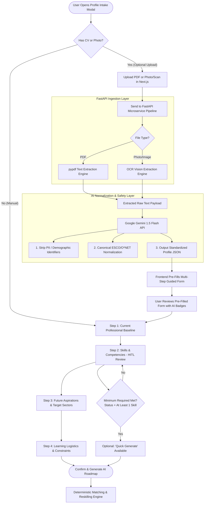

# SkillVerse AI — Profile Intake & Human-in-the-Loop (HITL) Specification

**Document Version:** 1.0.0  
**Project:** SkillVerse AI (SDC-HACKATHON-2026 — Domain 1)  
**Status:** Approved for Implementation  

---

## 1. Overview & Core Philosophy

The **Profile Intake** is the initial touchpoint for users of SkillVerse AI. To maximize accessibility across diverse demographics (including non-technical workers, TVET graduates, and career switchers), the intake operates on a **Unified Multi-Step Guided Form with Integrated AI Pre-Fill & HITL Review**.

### Key Architectural Tenets:
1. **Primary Mechanism = Multi-Step Guided Form:** The core intake is an accessible, progressive multi-step wizard. Users do not need a pre-existing resume to use the platform.
2. **Optional Quick AI Pre-Fill Pipeline (FastAPI + Gemini Flash):** 
   * When a user uploads a PDF or photo/scan, the document is sent directly to the **FastAPI microservice pipeline**.
   * FastAPI uses **`pypdf`** (for PDF text parsing) or an **OCR engine** (for scanned images/photos) to extract the raw text content.
   * The raw extracted data is then sent to the **Google Gemini 1.5 Flash API** to scrub PII and normalize raw expressions into standardized, structured entities aligned with **ESCO / O*NET** taxonomy.
   * The structured JSON output is returned to the frontend to **pre-fill the Multi-Step Guided Form**.
3. **Form Acts as HITL Review:** Rather than forcing users into a separate, disjointed verification modal after uploading, the multi-step form itself serves as the **Human-in-the-Loop (HITL)** review. Pre-filled fields are highlighted, allowing users to inspect, correct, add, or remove skills and data.
4. **Low Friction (Minimal Mandatory Fields):** Only the bare minimum data required to trigger vector matching is compulsory. All other fields are optional with smart defaults, allowing users to skip straight to recommendations if desired.
5. **Demographic-Blind Privacy (SDG 5 & SDG 10):** All personally identifiable information (PII) and demographic bias indicators (e.g., NRIC, age, gender, race, address) are strictly excluded or pre-scrubbed before vectorization.

---

## 2. End-to-End Intake Workflow



---

## 3. Form Steps & Field Specifications (Mandatory vs. Optional)

### Summary Matrix
* **Total Mandatory Fields:** **2** (Employment Status + At least 1 Skill)
* **Total Optional Fields:** **11** (All populated with sensible fallbacks if skipped)

---

### Step 1: Current Professional Baseline
*Captures current occupational context to establish the user's starting point.*

| Field Name | Input Type | Requirement | Default / Fallback if Skipped | Description & Pre-Fill Logic |
| :--- | :--- | :--- | :--- | :--- |
| **Document Auto-Fill** | File Upload (PDF, PNG, JPG, WebP) | **OPTIONAL** | N/A (Manual fill) | Drag-and-drop box to extract data into the form via Gemini 1.5 Flash OCR. |
| **Current Employment Status** | Radio Cards / Pill Group | **MANDATORY** | None | Options: `Employed (At-Risk)`, `Student / Fresh Grad`, `Career Switcher`, `Jobseeker / Unemployed`. |
| **Current / Recent Job Title** | Text Input with Autocomplete | **OPTIONAL** | `"General Professional"` | e.g., *Customer Service Assistant, Accounts Clerk, Data Entry Operator*. Pre-filled from CV. |
| **Industry / Sector** | Dropdown | **OPTIONAL** | `"General / Cross-Industry"` | e.g., *Retail, Logistics, Manufacturing, Finance, Healthcare, Technology, Agriculture*. |
| **Highest Education Level** | Dropdown | **OPTIONAL** | `"Not Specified"` | Options: `Secondary / SPM / STPM`, `TVET / Vocational Certificate`, `Diploma`, `Bachelor's Degree`, `Master's / PhD`. |
| **Years of Experience** | Pill Buttons / Slider | **OPTIONAL** | `"1-3 years"` | Options: `<1 year`, `1-3 years`, `3-5 years`, `5+ years`. |

---

### Step 2: Skills & Competencies (Primary HITL Area)
*Defines the user's current capabilities. This is the primary input for ESCO/O\*NET vector alignment and gap calculation.*

| Field Name | Input Type | Requirement | Default / Fallback if Skipped | Description & Pre-Fill Logic |
| :--- | :--- | :--- | :--- | :--- |
| **Skill Badges (Canonical ESCO/O\*NET)** | Interactive Chip List (`x` to delete, `+` to add) | **MANDATORY** *(Min. 1 skill)* | None (At least 1 required) | Pre-filled with normalized skills from CV or selected via search. Users can remove false-positives and add unlisted skills. |
| **Skill Proficiency Level** | Per-badge dropdown toggle | **OPTIONAL** | `"Intermediate"` | Options: `Beginner`, `Intermediate`, `Advanced`. Can be set per skill badge. |
| **Tools & Software Used** | Tag input / Multi-select | **OPTIONAL** | Empty list `[]` | e.g., *Microsoft Excel, SAP, Canva, QuickBooks, Python, AutoCAD, POS Systems*. |
| **Daily Tasks / Casual Description** | Multi-line Textarea | **OPTIONAL** | Empty string `""` | Free-form text (e.g., *"I reply to customer queries, handle returns, and balance cash drawers"*). AI standardizes this into ESCO skills. |
| **Language Proficiencies** | Multi-select Checkboxes | **OPTIONAL** | User's current UI locale | Options: `English`, `Bahasa Malaysia`, `Chinese (Mandarin)`, `Tamil`, `Other`. Crucial for Malaysian labor matching. |

---

### Step 3: Future Aspirations & Target Sectors
*Guides the trajectory of recommended roles and macro scenario weightings.*

| Field Name | Input Type | Requirement | Default / Fallback if Skipped | Description & Pre-Fill Logic |
| :--- | :--- | :--- | :--- | :--- |
| **Career Transition Goal** | Card Selector | **OPTIONAL** | `"Explore High-Growth Roles"` | Options: `Up-skill in current field`, `Re-skill into a new future role`, `Explore High-Growth Roles`. |
| **Target Resilient Sectors** | Multi-select Cards | **OPTIONAL** | `"All Sectors"` | Options: `Clean Energy & ESG`, `Responsible AI & Digital`, `Smart Logistics & Automation`, `Clean Healthcare`, `Precision Agritech`. |
| **Target Role Title (if any)** | Text Input with Suggestions | **OPTIONAL** | Empty (AI suggests best match) | e.g., *Prompt Specialist, ESG Reporting Assistant, Logistics Coordinator*. |
| **Preferred Work Arrangement** | Radio Pills | **OPTIONAL** | `"Any / Open"` | Options: `Remote`, `Hybrid`, `On-site`, `Any / Open`. |

---

### Step 4: Learning Logistics & Constraints
*Calibrates the Reskilling Pathway Generator to synthesize realistic timelines and relevant course catalogs.*

| Field Name | Input Type | Requirement | Default / Fallback if Skipped | Description & Pre-Fill Logic |
| :--- | :--- | :--- | :--- | :--- |
| **Weekly Time Commitment** | Pill Selector | **OPTIONAL** | `"3-5 hours/week"` | Options: `1-3 hours/week`, `3-5 hours/week`, `5-10 hours/week`, `10+ hours/week`. |
| **Preferred Learning Providers** | Multi-select Checkboxes | **OPTIONAL** | Free + HRD Corp selected | Options: `Free & Open Access (Coursera audit, edX, freeCodeCamp)`, `HRD Corp Claimable (Malaysia)`, `Industry Certifications`. |
| **Output / Report Language** | Radio Selector | **OPTIONAL** | Active i18n locale | Options: `English (en)`, `Bahasa Melayu (ms)`, `中文 (zh)`. Controls the generated roadmap language. |

---

## 4. The Human-in-the-Loop (HITL) Experience

When a user provides a resume or image CV, the system processes it through a two-stage extraction and normalization pipeline before presenting it in the form:

1. **Stage 1 — FastAPI Ingestion & Text Extraction (`pypdf` / OCR):**
   * The uploaded file (PDF or Image) is posted from Next.js to the **FastAPI microservice endpoint** (on RunPod).
   * **For PDFs:** FastAPI parses the raw text content using **`pypdf`**.
   * **For Images/Photos (PNG, JPG, WebP scans):** FastAPI invokes the **OCR vision engine** to convert the visual image into raw text characters.
2. **Stage 2 — Gemini 1.5 Flash Normalization & PII Redaction:**
   * FastAPI sends the raw text payload to the **Google Gemini 1.5 Flash API**.
   * **PII & Bias Redaction:** Automatically strips IC/passport numbers, contact numbers, residential addresses, age, gender, and racial identifiers.
   * **Entity Normalization:** Standardizes casual statements (e.g. *"talked to customers and fixed printer issues"*) into structured JSON containing canonical **ESCO / O*NET** taxonomy nodes (e.g. *"Customer Relationship Management"*, *"Hardware Troubleshooting"*).
   * Returns a clean `ProfileIntakePayload` JSON object to the Next.js client.
3. **Stage 3 — Form Pre-Fill & Visual Cues:**
   * The frontend receives the normalized JSON and automatically populates the corresponding fields in the **Multi-Step Guided Form**.
   * Pre-filled fields are highlighted with a subtle indicator:  
     `✨ Auto-filled by AI — Click to modify`
   * Extracted competencies are rendered as interactive, editable chips in **Step 2** with a clear delete icon (`×`).
4. **Stage 4 — Human-in-the-Loop (HITL) In-Place Review:**
   * The user reviews the pre-filled fields directly in the form flow.
   * **Adjust & Polish:** Users can click `×` to delete irrelevant skills, click `+ Add Skill` to include missing competencies, and adjust self-assessed proficiency (`Beginner` / `Intermediate` / `Advanced`).
   * **"Quick Generate" Option:** Once baseline requirements are satisfied (Status in Step 1 + at least 1 skill in Step 2), users can either finish the remaining optional steps or click **⚡ Quick Generate (Use Smart Defaults)** to initiate the Deterministic Matching Engine immediately.

---

## 5. Fairness, Safety & Demographic-Blind Parsing (SDG 5 & 10)

To adhere to hackathon guidelines and ensure demographic-blind evaluation:

### Strictly Excluded / Scrubbed Fields:
* **Identification Numbers:** MyKad, Passport number, Driver's License.
* **Personal Contact Details:** Physical residential address, personal phone number.
* **Demographic Identifiers:** Age / Date of Birth, Gender, Race / Ethnicity, Religion, Marital Status.
* **Biometric / Visual Data:** Profile photos or headshots from resumes are dropped immediately after OCR text extraction and never stored or vectorized.

### Technical Safeguard:
The backend extraction prompt instructs Gemini 1.5 Flash to explicitly redact demographic variables and return only structured competencies, experience duration, and technical tooling.

---

## 6. TypeScript Data Contract

```typescript
export type EmploymentStatus = 
  | 'employed_at_risk' 
  | 'fresh_grad_student' 
  | 'career_switcher' 
  | 'jobseeker';

export type SkillProficiency = 'beginner' | 'intermediate' | 'advanced';

export interface UserSkillItem {
  id: string;
  name: string;
  escoUri?: string;
  proficiency: SkillProficiency;
  isAiExtracted: boolean;
}

export interface ProfileIntakePayload {
  // Step 1: Baseline
  employmentStatus: EmploymentStatus; // MANDATORY
  currentJobTitle?: string;           // OPTIONAL
  industry?: string;                  // OPTIONAL
  educationLevel?: string;            // OPTIONAL
  yearsOfExperience?: string;         // OPTIONAL

  // Step 2: Skills & Competencies (HITL)
  skills: UserSkillItem[];            // MANDATORY (min length: 1)
  toolsAndSoftware?: string[];        // OPTIONAL
  casualDescription?: string;         // OPTIONAL
  languages?: string[];               // OPTIONAL

  // Step 3: Aspirations
  careerGoal?: 'upskill' | 'reskill' | 'explore'; // OPTIONAL
  targetSectors?: string[];                       // OPTIONAL
  targetJobTitle?: string;                        // OPTIONAL
  workArrangement?: 'remote' | 'hybrid' | 'onsite' | 'any'; // OPTIONAL

  // Step 4: Learning Logistics
  weeklyCommitmentHours?: '1-3' | '3-5' | '5-10' | '10+'; // OPTIONAL (Default: '3-5')
  learningProviders?: Array<'free_open' | 'hrd_corp' | 'industry_cert'>; // OPTIONAL
  outputLanguage: 'en' | 'ms' | 'zh';             // OPTIONAL (Default: UI locale)
}
```
