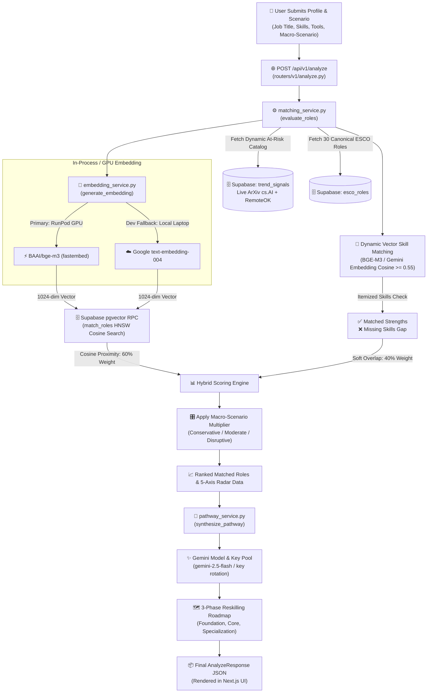

# SkillVerse AI - Analysis Engine End-to-End Workflow

This document provides a comprehensive, step-by-step walkthrough of the **Analysis Engine** in `src/fastapi`, explaining how **BGE-M3**, **Supabase pgvector**, **SYNONYM_MAP**, and **Gemini** work together to evaluate a candidate and generate an actionable reskilling roadmap.

---

## 1. High-Level Architecture Flowchart



---

## 2. Step-by-Step Execution Lifecycle

### Step 1: Intake & Validation (`POST /api/v1/analyze`)
* **File:** [`src/fastapi/routers/v1/analyze.py`](file:///c:/Users/Owner/Documents/GitHub/SDC-HACKATHON-2026/src/fastapi/routers/v1/analyze.py)
* **Input Payload:**
  ```json
  {
    "profile": {
      "fullName": "Sarah Tan",
      "currentJobTitle": "Data Associate",
      "industry": "Technology",
      "skills": [
        {"id": "1", "name": "Python", "proficiency": "intermediate"},
        {"id": "2", "name": "Excel", "proficiency": "advanced"},
        {"id": "3", "name": "Manual Data Entry", "proficiency": "advanced"}
      ],
      "toolsAndSoftware": ["MySQL", "PowerBI"]
    },
    "macroScenario": "disruptive",
    "locale": "en"
  }
  ```
* Validated against Pydantic schema [`AnalyzeRequest`](file:///c:/Users/Owner/Documents/GitHub/SDC-HACKATHON-2026/src/fastapi/schemas/analysis.py).

---

### Step 2: Dynamic At-Risk Skill Detection (Live Market Ingestion)
* **File:** [`src/fastapi/services/matching_service.py`](file:///c:/Users/Owner/Documents/GitHub/SDC-HACKATHON-2026/src/fastapi/services/matching_service.py#L351-L365)
* **Mechanism:** 
  1. Queries the Supabase `trend_signals` table (which is populated continuously by ArXiv `cs.AI` and RemoteOK API crawlers).
  2. Compares user skills against declining competencies ($V_s < -0.2$).
* **Example Detection:**
  * User skill `"Manual Data Entry"` matches declining signal ($V_s = -0.45$).
  * The engine tags it under `atRiskCompetencies` with concrete citations:
    * *Citation:* `"Rapid decline due to Intelligent Document Processing (IDP) - WEF Future of Jobs 2025"`

---

### Step 3: Dense Semantic Vector Generation (`BGE-M3`)
* **File:** [`src/fastapi/services/embedding_service.py`](file:///c:/Users/Owner/Documents/GitHub/SDC-HACKATHON-2026/src/fastapi/services/embedding_service.py#L116-L203)
* **Action:**
  1. Assembles a composite semantic summary string:
     ```text
     "Candidate Profile: Data Associate. Sector: Technology. Competencies: Python, Excel, Manual Data Entry, MySQL, PowerBI."
     ```
  2. Passes the text to `generate_embedding(profile_summary)`.
  3. **Execution Tiers:**
     * **Tier 1 (Production on RunPod GPU):** In-process `BAAI/bge-m3` via `fastembed` generates a **1024-dimensional float vector** directly in memory (<50ms).
     * **Tier 2 (Local Laptop Development):** Gemini `text-embedding-004` (normalized to 1024-dim) so your laptop doesn't require a dedicated GPU.

---

### Step 4: Vector Similarity Search via Supabase pgvector
* **File:** [`src/fastapi/services/matching_service.py`](file:///c:/Users/Owner/Documents/GitHub/SDC-HACKATHON-2026/src/fastapi/services/matching_service.py#L223-L260)
* **Action:**
  * Sends the 1024-dim vector to the Supabase PostgreSQL stored procedure `rpc/match_roles`:
    ```sql
    SELECT id, role_id, title, (1 - (embedding <=> query_embedding)) AS similarity
    FROM esco_roles
    ORDER BY embedding <=> query_embedding
    LIMIT 5;
    ```
  * Uses the **HNSW (Hierarchical Navigable Small World)** vector index for sub-millisecond retrieval.
  * Outputs the top matching ESCO roles along with their mathematical `cosine_val`.

---

### Step 5: Dynamic Semantic Vector Skill Matching & Gap Analysis
* **File:** [`src/fastapi/services/matching_service.py`](file:///c:/Users/Owner/Documents/GitHub/SDC-HACKATHON-2026/src/fastapi/services/matching_service.py)
* **Elimination of Static Dictionaries:**
  * Rather than relying on a hardcoded synonym dictionary, the system performs **dynamic dense vector comparison** on each candidate skill against the role's required competencies.
* **The Mechanism:**
  1. **Exact & Substring Containment:** Fast-path check (e.g. `"Python"` in `"Python Scripting"`).
  2. **Token Jaccard Overlap:** Soft string metric ($\ge 0.60$).
  3. **Dense Vector Cosine Similarity:** Computes $\cos(\vec{u}, \vec{r})$ using 1024-dim BGE-M3 / Gemini embeddings with in-memory caching.
     * `"Excel"` vs `"spreadsheet data manipulation"` $\rightarrow \text{sim} = 0.63 \ge 0.55$ ✅
     * `"PowerBI"` vs `"business intelligence dashboards"` $\rightarrow \text{sim} = 0.61 \ge 0.55$ ✅
     * `"Kubernetes"` vs `"container orchestration"` $\rightarrow \text{sim} = 0.71 \ge 0.55$ ✅
     * Language-agnostic: Works across English, Malay, and Chinese without manual dictionary maintenance.
* **Outcome:**
  * Matched skills are placed into `matchedStrengths`.
  * Unmatched role requirements are placed into `skillsGap`.
  * Calculates `soft_overlap_ratio`:
    $$\text{SoftOverlap} = \frac{|\text{matchedStrengths}|}{|\text{requiredSkills}|}$$

---

### Step 6: Hybrid Match Scoring & Scenario Multipliers
* **File:** [`src/fastapi/services/matching_service.py`](file:///c:/Users/Owner/Documents/GitHub/SDC-HACKATHON-2026/src/fastapi/services/matching_service.py#L382-L393)
* **The Mathematical Formula:**
  $$\text{BaseMatch} = 0.60 \times \text{Cosine (BGE-M3 Macro)} + 0.40 \times \text{SoftOverlap (Dynamic Vector Micro)}$$

* **Macro-Scenario Adjustment:**
  $$\text{FinalScore} = \text{clamp}\big(0.15,\, 1.0,\, \text{BaseMatch} \times M_{\text{scenario}}\big)$$

  | Macro Scenario | Emerging AI Roles (e.g. AI Engineer) | Routine Data Roles |
  | :--- | :---: | :---: |
  | **Conservative** | $1.00\times$ | $0.95\times$ |
  | **Moderate** | $1.15\times$ | $0.85\times$ |
  | **Disruptive** | $1.30\times$ | $0.70\times$ |

---

### Step 7: 5-Axis Radar Chart Calibration
* **File:** [`src/fastapi/services/matching_service.py`](file:///c:/Users/Owner/Documents/GitHub/SDC-HACKATHON-2026/src/fastapi/services/matching_service.py#L415-L435)
* Calibrates candidate baseline against the target role requirement across 5 standardized competency axes:
  1. **Technical Aptitude**
  2. **Domain Operations**
  3. **Automation Resilience**
  4. **Learning Agility**
  5. **Strategic Leadership**

---

### Step 8: 3-Phase Reskilling Roadmap Synthesis (`Gemini`)
* **File:** [`src/fastapi/services/pathway_service.py`](file:///c:/Users/Owner/Documents/GitHub/SDC-HACKATHON-2026/src/fastapi/services/pathway_service.py)
* **Action:**
  * Takes the top-ranked role, along with the user's specific `skillsGap` from Step 5, and prompts the **Gemini Multi-Key Pool** with strict JSON schema enforcement:
* **The 3 Generated Milestones:**
  1. **Phase 1: Foundation (0–3 months)**
     * Resolves immediate prerequisite gaps.
     * Recommends concrete courses (e.g., Coursera, HRD Corp Malaysia).
  2. **Phase 2: Core Capability (3–6 months)**
     * Hands-on implementation and portfolio project blueprints.
  3. **Phase 3: Applied Specialization (6–12 months)**
     * Advanced industry certifications and real-world deployment.
* **Localization:**
  * Automatically localized to the requested language (`en` English, `ms` Bahasa Melayu, `zh` Chinese).

---

### Step 9: Final Response Assembly
* The API returns the complete [`AnalyzeResponse`](file:///c:/Users/Owner/Documents/GitHub/SDC-HACKATHON-2026/src/fastapi/schemas/analysis.py):
  * Ranked `roles`: Match score, scenario multiplier, SDG alignments, strengths, and gaps.
  * `radarData`: 5-axis competency comparison.
  * `roadmap`: 3-phase synthesized milestones with hours, certifications, and portfolio projects.
  * Rendered seamlessly by the Next.js frontend!

---

## 3. Dynamic Knowledge Architecture: Beyond Static Datasets

| Feature Dimension | Static MVP Approach (Old) | SkillVerse AI Hackathon Architecture (Modern) |
| :--- | :--- | :--- |
| **Role Catalog Scope** | Fixed 30 hardcoded ESCO roles | **Dynamic Tri-Tier Role Catalog (45+ to ∞ roles)**<br/>• **Tier 1 (Market Ingestion):** Continuous ingestion of emerging roles from RemoteOK & ArXiv *cs.AI* via [`trend_sync_service.py`](file:///c:/Users/Owner/Documents/GitHub/SDC-HACKATHON-2026/src/fastapi/services/trend_sync_service.py)<br/>• **Tier 2 (Official Taxonomy):** 45+ Canonical ESCO occupations from European Commission API via [`ingest_real_esco.py`](file:///c:/Users/Owner/Documents/GitHub/SDC-HACKATHON-2026/src/fastapi/db/ingest_real_esco.py)<br/>• **Tier 3 (Zero-Shot Synthesis):** Instant competency profile generation for novel user-entered target titles |
| **Skill Matching Engine** | Hardcoded `SYNONYM_MAP` dictionary (brittle, 100 entries) | **Dynamic Semantic Vector Proximity (0.58 Cosine)**<br/>Dense 1024-dim BGE-M3 / Gemini embeddings with fast exact/substring/token-overlap short-circuiting. Fully language-agnostic across EN, MS, and ZH. |
| **Signal Trend Grounding** | Static CSV or mock numbers | **Live Real-World Ingestion**<br/>Real-time crawling of RemoteOK API and ArXiv *cs.AI* research with clickable citations and hourly velocity metrics. |
| **Execution Performance** | 40s+ sequential API latency | **Sub-2s Hybrid Retrieval**<br/>HNSW vector search in Supabase Postgres + local persistent skill embedding cache ([`skill_embeddings_cache.json`](file:///c:/Users/Owner/Documents/GitHub/SDC-HACKATHON-2026/src/fastapi/db/skill_embeddings_cache.json)). |
| **Deployment Portability** | Requires expensive GPU or crashes | **Dual Tier:** In-process GPU `BAAI/bge-m3` on RunPod; auto-fallback to Gemini 1024-dim API on local laptop development. |
