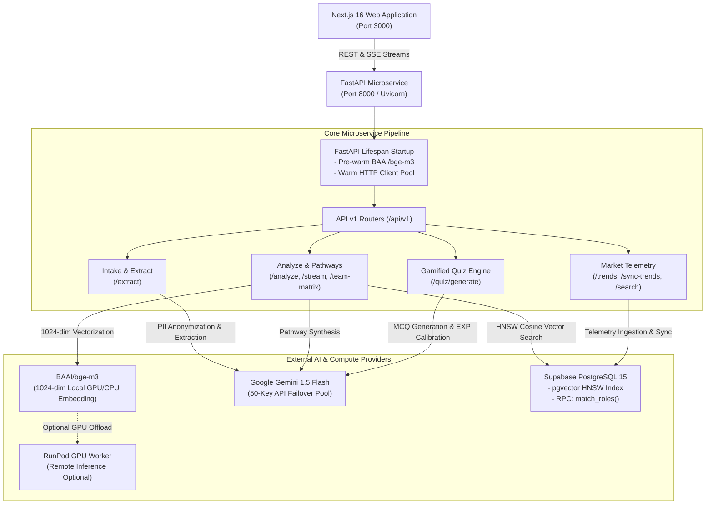

# SkillVerse AI - FastAPI Computational AI Microservice

The FastAPI microservice is the computational and intelligence backbone of **SkillVerse AI**. It handles compute-heavy machine learning inference, dense vector embedding generation, multimodal document parsing, real-time labor market telemetry, and dynamic reskilling pathway synthesis.

---

## 📌 Architecture Overview



---

## 🚀 Key Features & Capabilities

1. **Multimodal Document Parsing (`/api/v1/extract`)**
   - Supports text-based resumes (PDF) and CV image scans (PNG, JPG, JPEG, WEBP).
   - In-memory OCR and automated **PII sanitization** (removes name, gender, age, address) before taxonomic classification to ensure algorithmic fairness (SDGs 5 & 10).
   - Standardizes user competencies into canonical **European ESCO** and **O\*NET** entities.

2. **Deterministic Hybrid Career Matching (`/api/v1/analyze`)**
   - Implements the dual-track deterministic matching formula:
     $$\text{Match Score} = 0.60 \times \text{Macro Vector Proximity} + 0.40 \times \text{Micro Skill Overlap}$$
   - Generates 1024-dimensional dense semantic profile vectors via `BAAI/bge-m3`.
   - Executes sub-millisecond HNSW cosine searches against 104+ occupational benchmarks in Supabase.
   - Dynamically calibrates 5-axis Recharts radar competency data.

3. **Real-Time Streaming Engine (`/api/v1/analyze/stream`)**
   - Streams Server-Sent Events (SSE) providing transparent step-by-step progress feedback across 5 distinct computational phases.
   - Reactive keep-alive heartbeats to prevent proxy timeout disconnections.

4. **Dynamic Reskilling Pathway Synthesis (`/api/v1/analyze/synthesize-roadmap`)**
   - Synthesizes personalized 3-phase reskilling roadmaps using Google Gemini.
   - Recommends verified free audit courses (Coursera, edX) and Malaysian **HRD Corp claimable** training credentials.
   - Generates localized titles, milestones, and objectives across English, Malay, and Chinese.

5. **Live Labor Market Telemetry & Frontier Skill Ingestion (`/api/v1/trends`)**
   - Synchronizes real-time signals by scraping research abstracts from **ArXiv cs.AI** and tech job feeds from **RemoteOK**.
   - Computes Skill Trend Velocity ($V_s = \Delta\text{Market Demand} / \Delta t$) to classify skills into `emerging`, `stable`, or `declining`.
   - Dynamic Frontier Skill Search: Automatically synthesizes and vectors unindexed skills on-the-fly to prevent taxonomy obsolescence.

6. **Cohort Workforce Analytics (`/api/v1/analyze/team-matrix`)**
   - Evaluates multi-candidate cohorts against target roles using a 3-tier hybrid pipeline (Exact $\rightarrow$ Token Overlap $\rightarrow$ BGE-M3 Dense Cosine).
   - Returns ranked candidate profiles, competency deficit heatmaps, and HRD Corp cohort recommendations.

7. **Gamified Milestone Quizzes & EXP Leveling (`/api/v1/quiz/generate`)**
   - Generates 10-question technical competency scenario quizzes for each roadmap phase.
   - Evaluates and assigns Experience Points (EXP) to drive user progression and continuous learning momentum.

---

## 📂 Directory Layout

```
src/fastapi/
├── main.py                     # ASGI application entrypoint, CORS & lifespan lifecycle
├── config.py                   # Pydantic BaseSettings configuration & Gemini pool loader
├── requirements.txt            # Python dependencies
├── Dockerfile                  # Container definition with pre-downloaded BGE-M3 weights
├── runpod_setup.sh             # One-click GPU bootstrap script for RunPod
├── .env.example                # Template configuration file
├── routers/
│   └── v1/
│       ├── __init__.py         # Master v1 APIRouter aggregator
│       ├── health.py           # Pod health check & available Gemini keys status
│       ├── extract.py          # Multimodal CV document parser & PII scrubber
│       ├── analyze.py          # Role matching, SSE streaming, roadmap synthesis & team matrix
│       ├── trends.py           # Market signal sync, TTL cache & dynamic skill search
│       └── quiz.py             # Milestone verification quiz & EXP reward engine
├── schemas/
│   ├── __init__.py             # Pydantic schema exports
│   ├── analysis.py             # Match role payloads, roadmaps & SSE event models
│   ├── profile.py              # Profile intake, extraction responses & normalization schemas
│   ├── quiz.py                 # Quiz questions, answer keys & scoring models
│   ├── team.py                 # Team skill matrix, candidate evaluation & deficit heatmaps
│   └── trends.py               # Skill search, velocity models & trend signals
└── services/
    ├── __init__.py             # Service exports
    ├── embedding_service.py    # BAAI/bge-m3 dense vector inference (Local / GPU / Remote)
    ├── gemini_service.py       # Google Gemini 1.5 Flash client with 50-key failover pool
    ├── http_client.py          # Persistent asynchronous HTTP client connection pool
    ├── analyze/                # Role evaluation, scenario multipliers & roadmap synthesis
    ├── extract/                # PDF text parser & image vision pre-processor
    ├── quiz/                   # Prompt synthesis & quiz validation logic
    └── trends/                 # ArXiv / RemoteOK ingestion, velocity calculations & skill search
```

---

## ⚙️ Environment Configuration

Copy `.env.example` to `.env` inside `src/fastapi/` (or populate the root `.env`):

```bash
cp src/fastapi/.env.example src/fastapi/.env
```

| Variable | Type | Default | Description |
| :--- | :--- | :--- | :--- |
| `PORT` | `int` | `8000` | Port on which Uvicorn will listen. |
| `DEBUG` | `bool` | `true` | Enables FastAPI auto-reload and verbose logging. |
| `ENABLE_LOCAL_BGE_M3` | `bool` | `true` | Loads `BAAI/bge-m3` locally on GPU/CPU for zero-latency embeddings without Gemini token consumption. |
| `RUNPOD_API_ENDPOINT` | `string` | `""` | Optional remote RunPod GPU endpoint (if offloading inference to a dedicated GPU worker). |
| `RUNPOD_API_KEY` | `string` | `""` | API key for authenticated RunPod GPU endpoints. |
| `SUPABASE_URL` | `string` | Required | Supabase project URL (`https://<project-ref>.supabase.co`). |
| `SUPABASE_SERVICE_ROLE_KEY` | `string` | Required | Supabase service role key (bypasses RLS for system operations). |
| `SUPABASE_ANON_KEY` | `string` | Optional | Supabase public anonymous key. |
| `GEMINI_API_KEY_1`...`50` | `string` | At least 1 | Google Gemini API key pool. The microservice automatically cycles through available keys to prevent rate limit bottlenecks. |

> [!NOTE]
> The microservice automatically detects environment variables from both `src/fastapi/.env` and the workspace root `.env`.

---

## 💻 Local Development Setup

### Prerequisites
- **Python**: Version `3.10` or higher (Python `3.11`, `3.12`, or `3.14` supported).
- Verify your Python installation:
  ```bash
  python --version
  ```

---

### Step-by-Step Installation

#### 1. Navigate to the FastAPI Directory
Ensure your shell's working directory is `src/fastapi`:
```bash
cd src/fastapi
```

#### 2. Create and Activate a Virtual Environment

**Windows (PowerShell):**
```powershell
python -m venv .venv
.\.venv\Scripts\Activate.bat
```

**macOS / Linux (Bash / Zsh):**
```bash
python3 -m venv .venv
source .venv/bin/activate
```

#### 3. Install Dependencies
```bash
pip install -r requirements.txt
```

> [!TIP]
> On the initial installation, PyTorch and Hugging Face dependencies (`transformers`, `sentence-transformers`, `fastembed`) will be installed.

#### 4. Run the Development Server
```bash
python -m uvicorn main:app --reload --port 8000
```

The service will start at:
- **API Server**: [http://127.0.0.1:8000](http://127.0.0.1:8000)
- **Interactive Swagger Docs**: [http://127.0.0.1:8000/docs](http://127.0.0.1:8000/docs)
- **Alternative ReDoc**: [http://127.0.0.1:8000/redoc](http://127.0.0.1:8000/redoc)

---

## 📡 API Reference & Endpoints

### 1. Health & Status

| Method | Endpoint | Description |
| :--- | :--- | :--- |
| `GET` | `/` | Root endpoint returning service metadata, status, and API links. |
| `GET` | `/api/v1/health` | Healthcheck reporting service status and the number of active Gemini keys in the pool. |

**Example Healthcheck Response:**
```json
{
  "status": "healthy",
  "service": "SkillVerse AI",
  "version": "1.0.0",
  "gemini_keys_available": 5
}
```

---

### 2. Autonomous Chatbot Agent

#### `POST /agent` (or `POST /api/v1/agent`)
Processes conversational inquiries from the frontend chatbot assistant with dual-tier LLM intelligence:
1. **Tier 1 (Primary)**: Local **Qwen 2.5** via Ollama / vLLM (`settings.LOCAL_LLM_MODEL`).
2. **Tier 2 (Failover)**: Instant automatic fallback to Google **Gemini API** key pool if Qwen times out, errors, or is offline.

- **Content-Type**: `application/json`
- **Body**:
  ```json
  {
    "message": "Can you analyze my skills and show my roadmap?",
    "history": [
      { "role": "user", "content": "Hi!" },
      { "role": "assistant", "content": "Hello! How can I assist you today?" }
    ],
    "locale": "en",
    "system_instruction": "Optional custom system instruction string"
  }
  ```

**Sample Response (Action Triggered):**
```json
{
  "success": true,
  "target": "/analysis",
  "message": "I will take you to the Skill Gap Analysis dashboard to review your customized career roadmap.",
  "args": {},
  "model_used": "qwen (qwen2.5:7b)"
}
```

**Sample Response (Conversational / General Query):**
```json
{
  "success": true,
  "target": null,
  "message": "SkillVerse AI uses ESCO and O*NET taxonomies to analyze your career gaps and design tailored reskilling pathways.",
  "args": {},
  "model_used": "gemini (GEMINI_API_KEY_5)"
}
```

---

### 3. Intake & Document Extraction

#### `POST /api/v1/extract`
Uploads a resume file (PDF) or CV image (PNG, JPG, WEBP). Executes OCR, scrubs PII, and normalizes skills into standard ESCO competencies.

- **Content-Type**: `multipart/form-data`
- **Body**: `file` (Binary document, max 10 MB)

**Sample Response:**
```json
{
  "success": true,
  "message": "PDF resume successfully extracted and standardized via Gemini AI (GEMINI_API_KEY_1).",
  "extractedProfile": {
    "currentJobTitle": "Customer Service Representative",
    "industry": "Customer Support",
    "educationLevel": "bachelor",
    "yearsOfExperience": "3-5",
    "skills": [
      { "name": "Customer Relationship Management", "category": "Soft Skills", "level": "advanced" },
      { "name": "Data Entry & Records Management", "category": "Administrative", "level": "intermediate" }
    ],
    "toolsAndSoftware": ["Zendesk", "Salesforce", "Microsoft Excel"],
    "careerGoal": "upskill",
    "targetSectors": ["Artificial Intelligence", "Cloud & DevOps"]
  },
  "rawTextPreview": "Customer service specialist with 4 years handling inbound escalations...",
  "extractionMethod": "gemini",
  "usedKey": "GEMINI_API_KEY_1"
}
```

---

### 3. Career Analysis & Reskilling

#### `POST /api/v1/analyze`
Evaluates a candidate's profile against the 104+ ESCO occupational benchmarks using hybrid matching ($0.60 \times \text{Macro} + 0.40 \times \text{Micro}$). Returns the Top 5 matched roles and Recharts radar calibration data.

- **Content-Type**: `application/json`
- **Key Parameters**: `profile` (User profile object), `macroScenario` (`moderate`, `accelerated_ai`, `green_economy`), `locale` (`en`, `ms`, `zh`), `autoSynthesizeRoadmap` (`boolean`).

#### `POST /api/v1/analyze/stream`
Server-Sent Events (SSE) endpoint streaming real-time status across 5 discrete processing phases:
1. Auditing at-risk competencies against Supabase trend signals.
2. Generating 1024-dimensional BGE-M3 semantic profile embedding.
3. Querying Supabase HNSW pgvector index & soft skill overlaps.
4. Calibrating Recharts radar axes & UN SDG alignments.
5. Emitting the final Top 5 discovered roles payload.

#### `POST /api/v1/analyze/synthesize-roadmap`
Synthesizes a 3-phase reskilling roadmap for an explicitly selected target role.

**Sample Request:**
```json
{
  "targetRoleId": "ai-data-annotator-lead",
  "profile": { ... },
  "macroScenario": "accelerated_ai",
  "locale": "en"
}
```

#### `POST /api/v1/analyze/team-matrix`
Manager workforce analytics: Evaluates an entire team or candidate cohort against a benchmark role, producing ranked candidate lists, deficit heatmaps, and HRD Corp cohort recommendations.

---

### 4. Market Trends & Telemetry

| Method | Endpoint | Description |
| :--- | :--- | :--- |
| `GET` | `/api/v1/trends` | Retrieves latest labor market trend signals with localized names and 60-second in-memory TTL caching. Query params: `locale` (`en`, `ms`, `zh`). |
| `POST` | `/api/v1/sync-trends` | Triggers live scraping and velocity computation pipeline from ArXiv cs.AI and RemoteOK. |
| `POST` | `/api/v1/trends/search` | Analyzes a specific skill. If not indexed, prompts Gemini to synthesize trilingual trend data and embeds new roles into Supabase. |
| `GET` | `/api/v1/trends/search` | URL query variant for skill search: `?query=Kubernetes&locale=zh`. |

---

### 5. Gamified Phase Verification Quiz

#### `POST /api/v1/quiz/generate`
Generates a 10-question technical competency scenario quiz tailored to a roadmap phase's planned competencies, with Gemini-calibrated EXP rewards (5 to 100 EXP).

**Sample Request:**
```json
{
  "roadmapId": "3fa85f64-5717-4562-b3fc-2c963f66afa6",
  "phaseIndex": 1,
  "targetRoleTitle": "Prompt Engineer & LLM Operations Specialist",
  "phaseTitle": "Foundations of Prompting & LLM Evaluation",
  "plannedSkills": ["Few-shot Prompting", "Chain-of-Thought", "RLHF Evaluation"],
  "locale": "en"
}
```

---

## 🐳 Docker Deployment

The included `Dockerfile` incorporates multi-stage caching, installs `libgomp1` for PyTorch, and pre-downloads the `BAAI/bge-m3` weights directly into the container image to eliminate runtime cold-start timeouts:

```bash
# 1. Build the Docker image
docker build -t skillverse-fastapi:latest .

# 2. Run the container
docker run -d \
  -p 8000:8000 \
  --env-file .env \
  --name skillverse-fastapi-service \
  skillverse-fastapi:latest
```

The container includes an integrated healthcheck:
```dockerfile
HEALTHCHECK --interval=30s --timeout=10s --start-period=20s --retries=3 \
  CMD curl -f http://localhost:8000/api/v1/health || exit 1
```

---

## ⚡ RunPod GPU Deployment

For high-throughput GPU hosting, SkillVerse AI includes `runpod_setup.sh`:

1. Deploy a RunPod GPU Pod (e.g., RTX 3090, RTX 4090, or A4000).
2. Clone the repository into your pod.
3. Run the bootstrap script:
   ```bash
   bash src/fastapi/runpod_setup.sh
   ```
4. The script automatically installs pinned PyTorch packages, pre-caches `BAAI/bge-m3` on the GPU, terminates stale instances, and starts Uvicorn in the background on port `8000`.

---

## 🛡️ Production Resilience & Optimizations

- **Pre-warmed Embedding Pipeline**: On application startup (`lifespan`), `BAAI/bge-m3` is loaded into memory in an asynchronous background thread, guaranteeing zero-latency inference on the very first user request.
- **50-Key Gemini Pool Rotation**: Manages a round-robin pool of up to 50 API keys (`GEMINI_API_KEY_1` to `GEMINI_API_KEY_50`), automatically bypassing per-minute quota limits and failovers.
- **Async Connection Pooling**: Reuses a single persistent `httpx.AsyncClient` pool with TCP keep-alive for all outgoing network operations.
- **In-Memory Cache (TTL)**: Caches localized market trend responses for 60 seconds to reduce Supabase egress and query latency.
